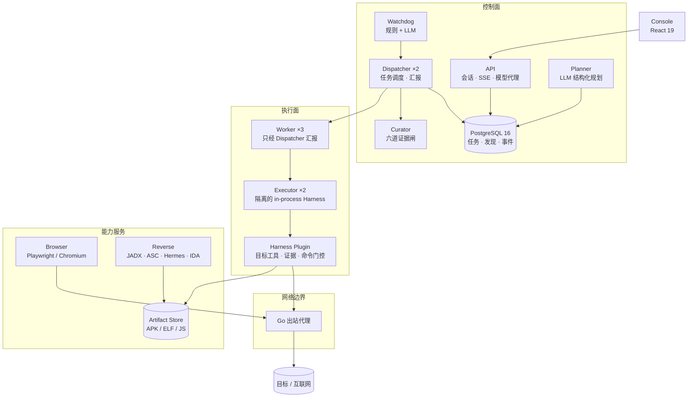
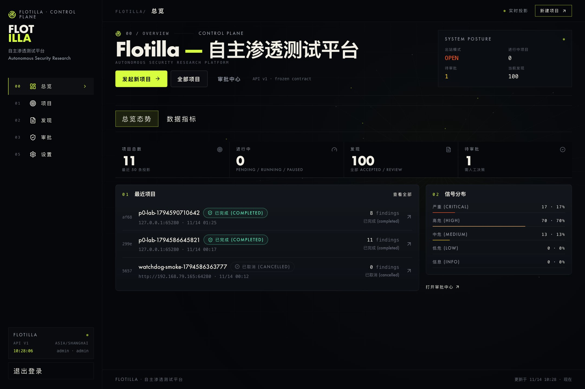
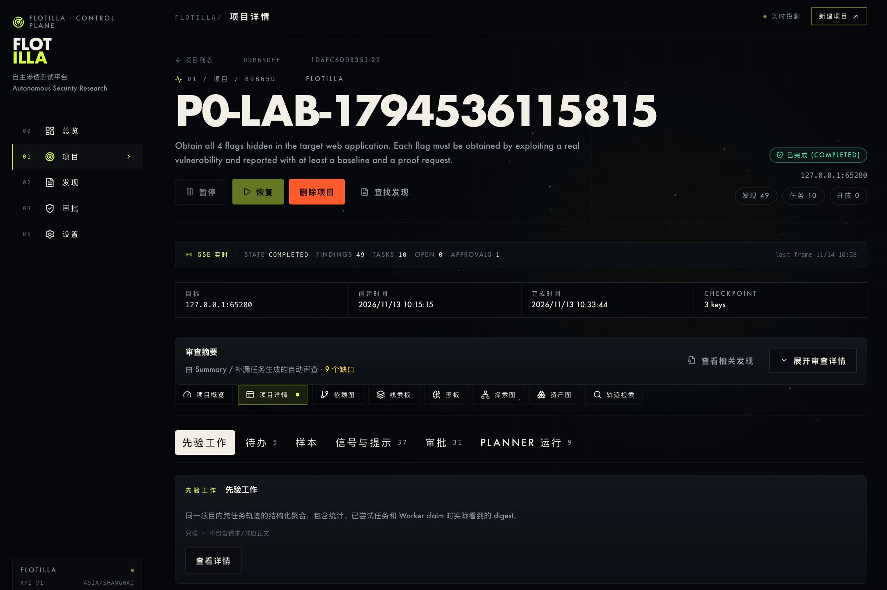
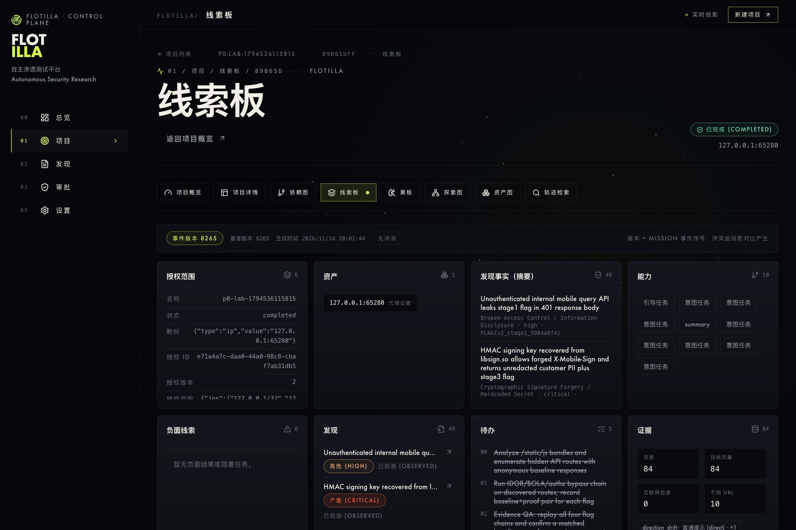

# Flotilla

> 自主渗透测试平台


填好目标资产（URL、IP 或域名）、任务目标和授权范围，Flotilla 就能开一个项目：Worker 领任务，Executor 在隔离环境里调用 HTTP、浏览器、APK/ELF 逆向工具，Curator 复核 Finding（发现），项目收尾时 Summary 出报告。Planner 会持续读快照、改计划、补任务。控制台可实时查看，也能暂停、注入提示或手动派单。

## 核心机制

### Super Agent 架构

Flotilla 把规划、执行和干预拆开：Planner 只规划，Worker 只执行，两者靠事件流转，运行中可以随时注入。

| 机制 | 做法 |
|---|---|
| 双层分工 | Planner 每轮读快照，重排任务、调优先级、取消走不通的方向，只写控制面记录、不挂目标工具；Worker 执行单个任务，必要时拆独立侦察子代理，子代理有自己的 toolset |
| 事件驱动 | mission events 和 triggers 驱动流转；Finding、资产、Watchdog 的信号直达 hint，需要判断的进 Planner |
| 批量规划 | Worker 报告不逐个唤醒 Planner：signals 先落库，防抖默认 5 秒、单次最多取 20 条，连同快照跑一次 reason pass |
| 运行中干预 | steering 走 `task_hints` → `steering-hints.jsonl` → 执行器每 250ms 读一次并注入下一个 step（`agent.steer()`），Worker 每 2.5 秒拉取，每次投递记一条 `task.hints_steered` 事件；CLI 路径用 chunked resume 兜底 |
| Watchdog | 规则加 LLM 的只读观察者：停滞、方向漂移、重复请求先去重提示，连续停滞升级到 Planner 和人工，Planner 判定无用可自动取消，10 分钟后回采效果 |


### 多图与共享记忆

任务、事件、发现和证据只存一份，下面的图和板都从这份数据派生。

| 视图 | 回答什么 | 数据来源 |
|---|---|---|
| 任务依赖图（DAG） | 哪些任务串行/并行、卡在哪、依赖是否满足 | tasks.depends_on + 任务状态 |
| 探索图 | 已经发现了什么、任务/事实/目标怎么关联、下一步从哪打 | 事件序列派生（mission/task/fact 节点） |
| 资产图 | 项目里有哪些资产、被任务/证据/事实覆盖了多少 | assets + 引用关系，带覆盖度 |
| 发现血缘 | 这条 Finding 怎么来的、证据是否共享、是否被取代 | findings / evidence |
| 黑板 | Planner 记住哪些类型化事实、开放意图和下一步可打点 | mission_facts / mission_intents 视图，frontier + recall |
| 线索板 | 人一屏看态势：授权范围、资产、发现摘要、能力、负面线索、待办、证据 | 事件序列八节投影（带事件版本与冲突标记） |

- 黑板是 Planner 的共享记忆：typed facts、intents、frontier、recall 注入 Planner 快照，规划基于事实，不靠对话历史。
- 线索板给人看：八节加 version/baseVersion/conflicts，一眼看出项目状态和哪块信息缺失。
- 图和板参与调度：DAG 决定串并行，探索图决定下一个打点，资产图看覆盖度，血缘回答一条 Finding 可不可信。

## 能打什么

`skills/` 里 16 个技能包（含 ck-router 入口）覆盖下面的方向；先打哪里、失败后换哪层由 ck-router 按目标类型分诊。

| 方向 | 覆盖 |
|---|---|
| Web 漏洞 | 注入（SQL、NoSQL、命令、SSTI）、XSS/CSRF/点击劫持、SSRF 与无头浏览器渲染、文件上传下载与路径穿越、反序列化/XXE、WAF 绕过 |
| 认证与权限 | JWT、OAuth、IDOR、验证码、2FA、前端路由与接口越权 |
| API 与协议 | REST、GraphQL、gRPC、WebSocket、网关、HTTP 走私、缓存 |
| 业务逻辑 | 支付、订单、库存类逻辑漏洞，并发竞态 |
| 资产与接口 | 子域与资产发现、JS 里的接口和密钥、未授权路径 |
| 移动端 | APK/小程序逆向、脱壳、组件漏洞、密钥与接口追踪 |
| 二进制与固件 | ELF/PE/SO、固件、协议逆向、内存破坏 |
| 云与基础设施 | 云资产、对象存储与元数据、K8s、中间件、CI/CD、依赖供应链 |
| 代码审计 | 源码和反编译产物的白盒审计，从输入点追到危险函数 |
| AI 应用 | Chatbot/RAG/AI 平台、代码执行沙箱、Agent 工具调用链路 |

## 架构与执行流程



执行流程：

1. 新建项目时写入项目记录、授权范围和初始任务；Planner 会按快照出计划、建任务、维护待办。
2. Worker 经 Dispatcher 领任务（lease + fencing），拉起 Executor，按步数和实际耗时上限执行，用 `http_request`、`browser_*`、`reverse_*` 调工具，目标流量经 Go 代理按授权范围放行。
3. Worker 把结果回报给 Dispatcher，提交 Finding（baseline + proof）；Curator 逐条过六道证据闸，证据不成立的不进报告；项目收尾时 Summary 出报告，状态经 SSE 推给控制台。

`docker compose up -d` 启动 postgres、proxy、api、frontend、dispatcher、executor、worker、browser、reverse、watchdog，以及一次性的 artifact-init。Planner 默认随栈启动（需要可用的 `LLM_API_KEY`）；不需要时 `docker compose stop planner`；副本数在 `docker-compose.yml` 里调。

## 界面

<table>
  <tr>
    <td width="50%"><br/><sub>总览：项目、发现、审批和信号分布</sub></td>
    <td width="50%"><br/><sub>项目详情：实时状态、任务和复核结果</sub></td>
  </tr>
</table>

<table>
  <tr>
    <td width="50%"><br/><sub>任务依赖图：按 depends_on 分层，串并行调度</sub></td>
    <td width="50%"><br/><sub>探索图：任务 / 事实 / 目标的发现关系</sub></td>
  </tr>
  <tr>
    <td width="50%"><br/><sub>黑板：类型化事实、frontier、检索（Planner 的共享记忆）</sub></td>
    <td width="50%"><br/><sub>线索板：八节态势投影（授权 / 资产 / 发现 / 负面线索 / 待办 / 证据）</sub></td>
  </tr>
</table>

其余页面：项目列表、审批中心、Watchdog 看板、指标、模型配置、资产图、轨迹检索、发现详情。

## 快速开始

Docker / Docker Compose；本地开发另需 Node.js 24+。

```bash
cp .env.example .env        # 至少填 LLM_API_KEY，按需改 LLM_BASE_URL / LLM_MODEL
docker compose up -d --build
open http://127.0.0.1:5173
```

系统首次启动会创建管理员 `admin` / `admin123`，首次登录强制改密（至少 12 位，含大小写字母、数字和特殊字符）。

控制台新建项目后，Worker 会自动领任务。

## 关键配置

`LLM_API_KEY` 必填，其余按需。常用变量：`LLM_BASE_URL` / `LLM_MODEL`、`EGRESS_MODE`（出站模式，默认 `scope`）、`PLANNER_*`、`WATCHDOG_*`、`ARTIFACT_MAX_BYTES`。默认值和完整列表见 [.env.example](.env.example)。

## 技术栈

| 层 | 技术 |
|---|---|
| 前端 | Vite、React 19、TypeScript strict、Tailwind v4 |
| 控制面 | Node.js 24、`node:http`、zod、PostgreSQL 16 |
| 执行 | DeepSeek Harness（in-process）、dispatcher + lease/fencing |
| 网络与能力服务 | Go 1.25 出站代理；Playwright；JADX、ASC、Hermes、IDA idalib |
| 部署 | Docker Compose |

## 目录结构

```text
flotilla/
├── packages/        # orchestrator、api、frontend、harness-plugin、curator、contracts、control-plane、tool-gateway
├── services/        # browser（Playwright）、reverse（JADX / ASC / Hermes / IDA idalib）
├── proxy/           # Go 出站代理
├── skills/          # 16 个技能包，ck-router 分诊
├── docs/            # 架构决策、API 契约、截图
├── docker-compose.yml
└── LICENSE
```

文档：[前端 API 契约](docs/api/frontend-api.md)、[ADR 目录](docs/decisions/)。

## License

[MIT](LICENSE) © 2026 Flotilla contributors

第三方组件（JADX / ASC / agent-skills 等）的许可见 [THIRD_PARTY_NOTICES.md](THIRD_PARTY_NOTICES.md)。

🚨仅用于自有靶场或已获得授权的目标。
