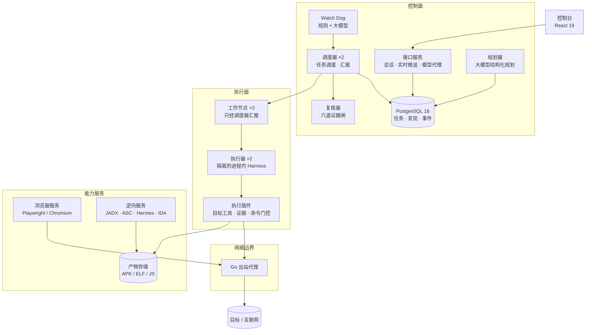
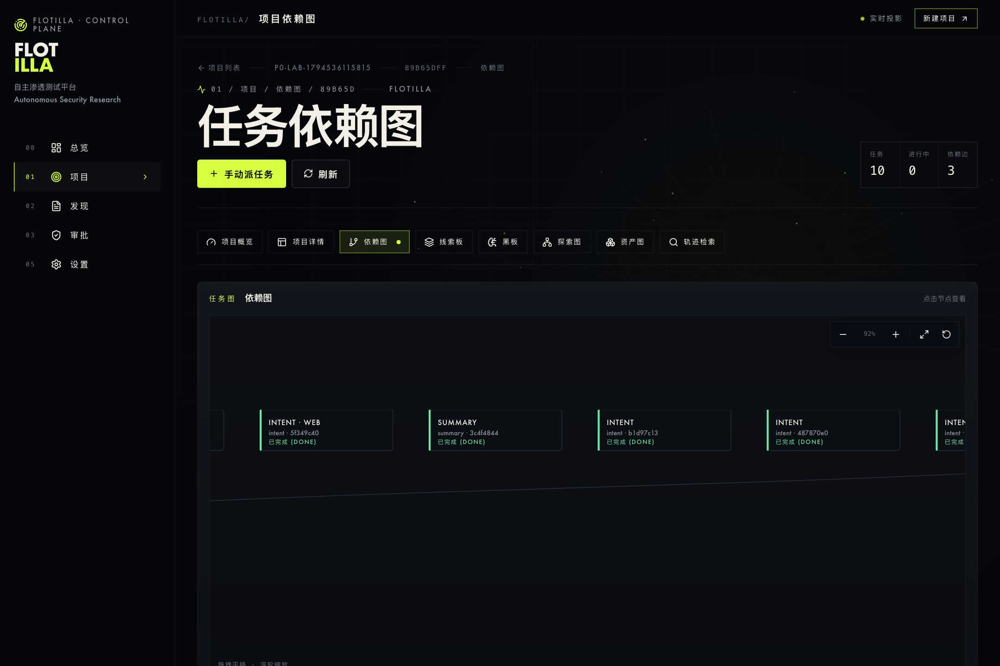
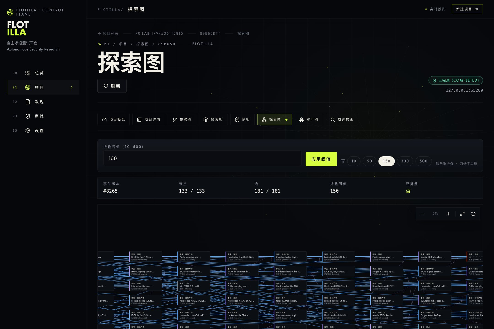
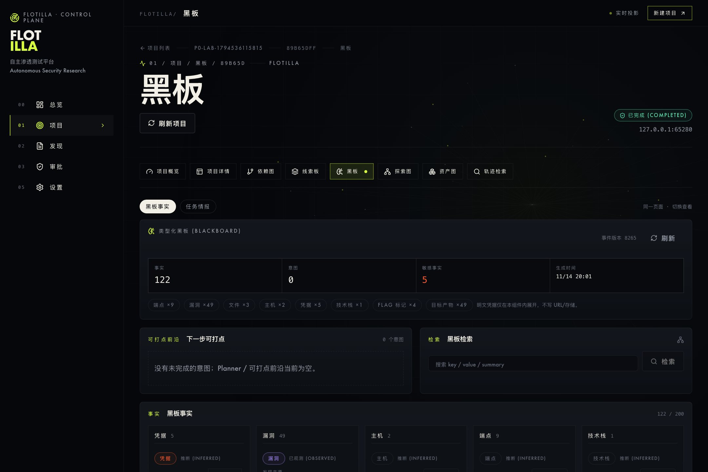

# Flotilla —— 自主渗透测试平台

> 如果我是安服你还会爱我吗？这是本安服仔摸鱼时候搓出来的产品，每个安服仔都有一个安研&红队梦……


填好目标资产（URL、IP 或域名）、任务目标和授权范围，Flotilla 就能开一个项目：规划器（Planner）默认随栈启动，持续读状态、改计划、补任务；工作节点（Worker）领任务，执行器（Executor）在隔离环境里调用 HTTP、浏览器、APK/ELF 逆向工具，复核器（Curator）检查发现（Finding），项目收尾时由总结任务（Summary）生成总结报告。控制台可实时查看，也能暂停、注入提示或手动派单。

## 核心机制

### 超级智能体架构（Super Agent）

Flotilla 把规划、执行和干预拆开：规划器只规划，工作节点只执行，两者靠事件流转，运行中可以随时注入。

| 机制 | 做法 |
|---|---|
| 双层分工 | 规划器每轮读快照，重排任务、调优先级、取消走不通的方向，只写控制面记录、不挂目标工具；工作节点执行单个任务，必要时拆独立侦察子代理（subagent），子代理有自己的工具集（toolset） |
| 事件驱动 | 任务事件与触发器驱动流转；发现、资产、Watch Dog 的提示直达工作节点，需要判断的交给规划器 |
| 批量规划 | 工作节点报告不逐个唤醒规划器：信号先落库，默认防抖 5 秒、单次最多取 20 条，连同快照跑一轮规划判断 |
| 运行中干预（steering） | 提示（hint）先写入 `task_hints`，再转成 `steering-hints.jsonl`；执行器每 250 毫秒读一次，在下一步注入（`agent.steer()`）；工作节点每 2.5 秒拉取，每次投递记一条 `task.hints_steered` 审计事件；命令行路径用分段续跑兜底 |
| Watch Dog | 规则加大模型的只读观察者：停滞、方向漂移、重复请求先去重提示，连续停滞升级到规划器和人工，规划器判定无用可自动取消，10 分钟后回采效果 |

### 多图与共享记忆

任务、事件、发现和证据只存一份，下面的图和板都从这份数据派生，不需要额外维护第二套事实。

| 视图 | 回答什么 | 数据来源 |
|---|---|---|
| 任务依赖图（DAG） | 哪些任务串行/并行、卡在哪、依赖是否满足 | 任务依赖关系与任务状态 |
| 探索图 | 已经发现了什么、任务/事实/目标怎么关联、下一步从哪打 | 事件序列派生（项目/任务/事实节点） |
| 资产图 | 项目里有哪些资产、被任务/证据/事实覆盖了多少 | 资产表与引用关系，带覆盖度 |
| 发现血缘 | 这条发现怎么来的、证据是否共享、是否被取代 | 发现表与证据表 |
| 黑板 | 规划器记住哪些类型化事实、开放意图和下一步可打点 | 事实/意图视图，加上待打点前沿（frontier）与检索 |
| 线索板 | 人一屏看态势：授权范围、资产、发现摘要、能力、负面线索、待办、证据 | 事件序列八节投影（带版本与冲突标记） |

- 黑板是规划器的共享记忆：类型化事实、意图、待打点前沿和检索结果会注入规划快照，规划基于事实，不靠对话历史。
- 线索板给人看：八节加版本号与冲突标记，一眼看出项目状态和哪块信息缺失。
- 图和板参与调度：任务依赖图决定串并行，探索图决定下一个打点，资产图看覆盖度，血缘回答一条发现可不可信。

## 能打什么

`skills/` 里 16 个技能包（含 ck-router 入口）覆盖下面的方向；先打哪里、失败后换哪层由 ck-router 按目标类型分诊。

| 方向 | 覆盖 |
|---|---|
| Web 漏洞 | 注入（SQL、NoSQL、命令、SSTI）、XSS/CSRF/点击劫持、SSRF 与无头浏览器渲染、文件上传下载与路径穿越、反序列化/XXE、WAF 绕过 |
| 认证与权限 | JWT、OAuth、IDOR、验证码、双因素认证、前端路由与接口越权 |
| 接口与协议 | REST、GraphQL、gRPC、WebSocket、网关、HTTP 走私、缓存 |
| 业务逻辑 | 支付、订单、库存类逻辑漏洞，并发竞态 |
| 资产与接口 | 子域与资产发现、JS 里的接口和密钥、未授权路径 |
| 移动端 | APK/小程序逆向、脱壳、组件漏洞、密钥与接口追踪 |
| 二进制与固件 | ELF/PE/SO、固件、协议逆向、内存破坏 |
| 云与基础设施 | 云资产、对象存储与元数据、K8s、中间件、CI/CD、依赖供应链 |
| 代码审计 | 源码和反编译产物的白盒审计，从输入点追到危险函数 |
| 智能体应用 | 聊天机器人/RAG/智能体平台、代码执行沙箱、智能体工具调用链路 |

## 架构与执行流程



执行流程：

1. 新建项目时写入项目记录、授权范围和初始任务；规划器默认随栈启动，会按快照出计划、建任务、维护待办。
2. 工作节点经调度器（Dispatcher）领任务，靠租约（lease）与防双写（fencing）保证同一任务只被一个节点执行；随后拉起执行器，按步数和实际耗时上限执行，用 `http_request`、`browser_*`、`reverse_*` 调工具，目标流量经 Go 代理按授权范围放行。
3. 工作节点把结果回报给调度器，提交发现，附基线请求（baseline）与证明请求（proof）；复核器逐条过六道证据闸，证据不成立的不进报告；项目收尾时生成总结报告，状态经实时推送（SSE）到控制台。

`docker compose up -d` 默认启动数据库、出站代理、接口服务、控制台、调度器、执行器、工作节点、浏览器服务、逆向服务、Watch Dog，以及一次性的产物初始化容器。规划器也默认随栈启动（需要可用的 `LLM_API_KEY`）；不需要时用 `docker compose stop planner`；副本数在 `docker-compose.yml` 里调。

## 界面

<table>
  <tr>
    <td width="50%"><br/><sub>总览：项目、发现、审批和信号分布</sub></td>
    <td width="50%"><br/><sub>项目详情：实时状态、任务和复核结果</sub></td>
  </tr>
</table>

<table>
  <tr>
    <td width="50%"><br/><sub>任务依赖图：按依赖分层，串并行调度</sub></td>
    <td width="50%"><br/><sub>探索图：任务 / 事实 / 目标的发现关系</sub></td>
  </tr>
  <tr>
    <td width="50%"><br/><sub>黑板：类型化事实、待打点前沿、检索（规划器的共享记忆）</sub></td>
    <td width="50%"><br/><sub>线索板：八节态势投影（授权 / 资产 / 发现 / 负面线索 / 待办 / 证据）</sub></td>
  </tr>
</table>

其余页面：项目列表、审批中心、Watch Dog 看板、指标、模型配置、资产图、轨迹检索、发现详情。

## 快速开始

Docker / Docker Compose；本地开发另需 Node.js 24+。

```bash
cp .env.example .env        # 至少填 LLM_API_KEY，按需改 LLM_BASE_URL / LLM_MODEL
docker compose up -d --build
open http://127.0.0.1:5173
```

系统首次启动会创建管理员 `admin` / `admin123`，首次登录强制改密（至少 12 位，含大小写字母、数字和特殊字符）。

控制台新建项目后，工作节点会自动领任务。

## 关键配置

`LLM_API_KEY` 必填，其余按需。常用变量：`LLM_BASE_URL` / `LLM_MODEL`、`EGRESS_MODE`（出站模式，默认 `scope`）、`PLANNER_*`、`WATCHDOG_*`、`ARTIFACT_MAX_BYTES`。默认值和完整列表见 [.env.example](.env.example)。

## 技术栈

| 层 | 技术 |
|---|---|
| 前端 | Vite、React 19、TypeScript 严格模式、Tailwind v4 |
| 控制面 | Node.js 24、`node:http`、zod、PostgreSQL 16 |
| 执行 | DeepSeek Harness（进程内）、调度器 + 租约/防双写 |
| 网络与能力服务 | Go 1.25 出站代理；Playwright；JADX、ASC、Hermes、IDA idalib |
| 部署 | Docker Compose |

## 目录结构

```text
flotilla/
├── packages/        # 编排、接口、控制台、执行插件、复核器、契约、控制面、工具网关
├── services/        # 浏览器服务（Playwright）、逆向服务（JADX / ASC / Hermes / IDA）
├── proxy/           # Go 出站代理
├── skills/          # 16 个技能包，ck-router 分诊
├── docs/            # 架构决策、接口契约、截图
├── docker-compose.yml
└── LICENSE
```

文档：[前端接口契约](docs/api/frontend-api.md)、[架构决策记录（ADR）](docs/decisions/)。

## License

[MIT](LICENSE) © 2026 Flotilla contributors

第三方组件（JADX / ASC / agent-skills 等）的许可见 [THIRD_PARTY_NOTICES.md](THIRD_PARTY_NOTICES.md)。

🚨仅用于自有靶场或已获得授权的目标。
