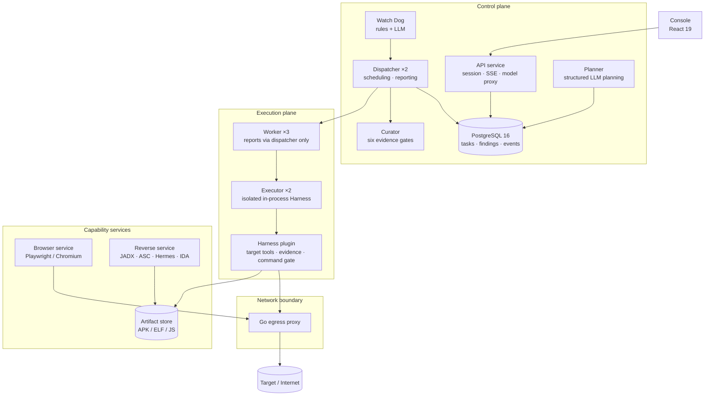

<p align="center">
  
  
</p>

<h1 align="center">Flotilla</h1>

<p align="center"><a href="README.md">中文</a> · English</p>

<p align="center"><strong>—— An autonomous penetration testing platform built on Super Agent architecture ——</strong></p>

<p align="center">
  <a href="https://github.com/zhaji2333/Flotilla/releases/latest"></a>
  
  
  
  
  
</p>

---

An autonomous penetration testing platform for explicitly authorized security testing — it plans, reviews, and self-corrects, with evidence for every step.

Some call pentesting a craft; others call it a game of patience and greed. Flotilla hands the game to a fleet of planners, workers, and executors: they hunt for clues, record evidence, and correct one another, flushing out every blind spot within the authorized scope. All you do is sit at the console and decide which sea to sail next.

`Super Agent Architecture` · `Multi-graph & Shared Memory` · `Agent Full-Duplex Runtime` · `Watch Dog Self-Correction` · `Multi-Agent Autonomy` · `Auditable Evidence Chain`

**Navigation**: [Quick start](#quick-start) · [What is this](#what-is-this) · [Screenshots](#screenshots) · [Capabilities](#capabilities) · [Architecture](#architecture) · [Installation](#installation) · [References](#references)

---

## Quick start

```bash
cp .env.example .env        # LLM_API_KEY is required; adjust LLM_BASE_URL / LLM_MODEL as needed
docker compose up -d --build
open http://127.0.0.1:5173  # default admin / admin123; password change is forced at first login
```

After you create a project in the console, workers claim tasks automatically. See [Installation](#installation) for the full steps, resource requirements, and optional configuration.

---

## What is this

Flotilla is a **multi-graph + multi-agent penetration testing system built around the Super Agent architectural idea**. Give it target assets (URL, IP, domain, attachment), an objective, and an authorized scope; it autonomously performs reconnaissance, validation, and evidence collection inside the authorization boundary, and produces a summary report when the project wraps up.

> This is a side project I built while slacking off at work… The README was written by AI and has a certain smell — even I find it hard to read — so here is the short version:

- The classic trio, done properly: role-based Multi-Agent (the Planner handles planning, decisions, and scheduling; the Worker is the task controller and can itself call Sub Agents; the Watch Dog patrols like a dog, watching whether the current task is drifting and correcting it) + a DAG graph, a blackboard, PostgreSQL + vulnerability authenticity validation, risky-command interception during pentesting, and so on.
- It borrows some ideas from DeepSeek's Super Agent architecture (two-layer split, event-driven, batching, full-duplex, watchdog) to achieve continuous, proactive, efficient, and persistent operation.
- Compliance logging is straightforward: every project, task, and Agent trace is explicitly recorded. Drift beyond the authorized boundary is still possible, so an LLM is used for boundary judgement — but that does not make it risk-free… if something goes wrong, all you can do is run.
- You can inject hints while a task is running and boldly hand your ideas and suggestions to the AI, enabling wish-driven pentesting (?).
- Future idea: from a client's perspective, I am an Agent too; my Agent is actually my Sub Agent, and my Agent's Sub Agent… so why not let clients call my Agent directly? I want the system to receive tasks from WeChat / WeCom / Feishu, run projects automatically, and report back to the user. As a poor security service engineer, I also want token-cost limits to reduce my own expenses.
- Last but not least: this project gave me some spare time to think about whether low-dignity, low-autonomy work that means nothing beyond earning a salary still has any meaning.

> One more plug: my pentesting SKILLs have been updated to v2 ([CkSKILLS v2](https://github.com/zhaji2333/CkSKILLS/tree/v2)).

---

## Screenshots

<table>
  <tr>
    <td width="50%"><br/><sub><b>Overview</b>: projects, findings, approvals, and signal distribution</sub></td>
    <td width="50%"><br/><sub><b>Project detail</b>: live state, tasks, and review results</sub></td>
  </tr>
  <tr>
    <td width="50%"><br/><sub><b>Task dependency graph</b>: layered by dependency, serial/parallel scheduling</sub></td>
    <td width="50%"><br/><sub><b>Exploration graph</b>: how tasks / facts / targets relate</sub></td>
  </tr>
  <tr>
    <td width="50%"><br/><sub><b>Blackboard</b>: typed facts, frontier, search (the Planner's shared memory)</sub></td>
    <td width="50%"><br/><sub><b>Clue board</b>: eight-section situation view (scope / assets / findings / negative clues / todos / evidence)</sub></td>
  </tr>
</table>

More pages: project list, approval center, Watch Dog dashboard, metrics, model configuration, asset graph, trace search, finding detail.

---

## Capabilities

### Autonomous planning and two-layer execution

The Planner only makes decisions each round: it reads control-plane snapshots, reorders tasks, adjusts priorities, cancels dead ends, and maintains todos. It only gets control-plane tools and cannot send requests to targets directly. The Worker claims and executes tasks, spawning isolated recon subagents when needed; the Executor runs the Harness in an isolated environment and performs the actual tool calls and evidence collection. The two layers communicate through task events and triggers, so a planning failure does not contaminate the execution plane, and an execution failure cannot rewrite the authorization.

### Multi-graph and shared memory

Every graph and board is a **derived read model over the same factual data**, with no second source of truth:

- **Task dependency graph**: layered by dependency, so serial/parallel scheduling and blockers are obvious at a glance;
- **Exploration graph**: relationships between projects, tasks, and facts, deciding where to strike next;
- **Asset graph**: assets within the project and their coverage, avoiding duplicated work and gaps;
- **Finding lineage**: where a finding came from, whether evidence is shared, and whether it was superseded;
- **Blackboard**: the Planner's shared memory — typed facts, open intents, the frontier, and recall;
- **Clue board**: a one-screen situation view for humans, with an eight-section projection plus version and conflict markers.

### Runtime injection (full-duplex)

You can change direction while a task is running: hints are persisted first, workers poll them every 2.5 seconds, and the executor checks every 250 milliseconds and injects them at the next step; every delivery is audited. No need to pause the task or wait for the next retry.

### Watch Dog self-correction

Watch Dog is a read-only observer: the rule layer watches for stalls, direction drift, and duplicate requests, while the LLM layer reviews direction; on a hit it de-duplicates hints first, escalates repeated stalls to the Planner and a human, and the Planner can auto-cancel tasks it deems useless. Outcomes are re-checked after 10 minutes, with hit rates shown on the dashboard.

### Evidence chain and review

A finding is not real just because "the model says so": it must bind to baseline and proof requests recorded for the task, and the Curator runs the six evidence gates one by one; findings whose evidence does not hold are excluded from the report, and questionable ones go to a human review queue. Every finding, evidence item, approval, and state change is replayable.

### Authorized network boundary

Target traffic has exactly one exit: the Go egress proxy. The proxy validates URLs, domains, IPs, and prefixes against the project's authorization, checks redirects hop by hop, protects against DNS rebinding, and allows internet research only through an allowlist; write actions are accounted for separately. The execution plane is isolated: workers have no database credentials, executors have no admin credentials, and model keys live only in the control plane.

### Capability services

Browser and reverse engineering run as separate services: the browser service runs Playwright/Chromium, while the reverse service bundles JADX, ASC, Hermes, and IDA idalib (the IDA image requires your own license and must stay private). Artifacts are mounted through the artifact store, and target traffic still goes through the proxy.

### Human-in-the-loop and observability

The console shows tasks, findings, traces, the blackboard, and the clue board in real time; it supports pause/resume/cancel/retry, manual dispatch, and an approval center (scope upgrades, finding review, command review, stalled-task review). Execution traces, tool calls, skill loading, and context injections are all inspectable.

### Skill system

`skills/` ships 16 domain skill packs, triaged by `ck-router` according to target type: where to strike first and which layer to fall back to do not depend on improvisation.

---

## Architecture



Execution flow:

1. Creating a project writes the project record, authorized scope, and initial tasks; the Planner starts with the stack and produces plans, creates tasks, and maintains todos from the snapshot.
2. Workers claim tasks through the Dispatcher, with leases and fencing so a task is only executed by one Worker; they then start the Executor, which runs within step and wall-clock limits and calls tools such as `http_request`, `browser_*`, and `reverse_*`. Target traffic passes through the Go proxy and is allowed according to the authorized scope.
3. Workers report results back to the Dispatcher and submit findings with a baseline and proof request; the Curator runs the six evidence gates; when the project wraps up, a Summary task produces the report, and state is pushed to the console via SSE.

Default deployment topology:

| Service | Default replicas | Responsibility |
|---|---|---|
| postgres | 1 | Tasks, findings, evidence, events, and audit |
| proxy | 1 | The single egress boundary, authorization checks, and audit |
| api | 1 | Sessions, REST, SSE, and model proxy |
| frontend | 1 | Console (nginx same-origin reverse proxy) |
| dispatcher | 2 | The only database write entry for worker reports; periodic ticks run on the leader only |
| executor | 2 | Isolated Harness execution |
| worker | 3 | Claim tasks, start executors, report results |
| browser | 1 | Playwright / Chromium capability service |
| reverse | 1 | JADX / ASC / Hermes / IDA reverse service |
| watchdog | 1 | Read-only observation and escalation hints |
| planner | 1 | Planning service, started with the stack by default |
| artifact-init | 1 (one-shot) | Initializes the artifact volume and exits |

---

## Installation

### Prerequisites

- Docker and Docker Compose v2;
- An OpenAI-compatible LLM API key (required);
- 16 GB of RAM or more recommended (the full stack includes 3 workers, 2 executors, 2 dispatchers, the browser and reverse services by default; limits are peaks, not steady-state usage);
- Node.js 24+ and pnpm for local development;
- For IDA decompilation: your own IDA installer and license, plus a private `reverse-ida` image — **never publish that image**.

### 1. Get the code

```bash
git clone https://github.com/zhaji2333/Flotilla.git
cd Flotilla
```

### 2. Configure

```bash
cp .env.example .env
```

At minimum:

```bash
LLM_API_KEY=sk-...            # required
LLM_BASE_URL=https://api.deepseek.com/v1
LLM_MODEL=deepseek-chat
```

Other common options: `EGRESS_MODE` (default `scope`, only the authorized scope is allowed), `PLANNER_*`, `WATCHDOG_*`, `ARTIFACT_MAX_BYTES`. See [.env.example](.env.example) for defaults and the full list.

### 3. Start

```bash
docker compose up -d --build
```

By default this starts the database, egress proxy, API service, console, 2 dispatchers, 2 executors, 3 workers, browser service, reverse service, Watch Dog, Planner, and a one-shot artifact-init container.

The Planner is enabled by default (a valid `LLM_API_KEY` is required). To stop it:

```bash
docker compose stop planner
```

Adjust concurrency:

```bash
WORKER_REPLICAS=1 EXECUTOR_REPLICAS=1 DISPATCHER_REPLICAS=1 docker compose up -d
```

For a lightweight core stack (without browser / reverse / Watch Dog):

```bash
WORKER_REPLICAS=1 EXECUTOR_REPLICAS=1 DISPATCHER_REPLICAS=1 \
docker compose up -d postgres proxy artifact-init api frontend dispatcher executor worker
```

Add capability services later with `docker compose up -d browser reverse watchdog`.

### 4. Access

| Entry | Address |
|---|---|
| Console | http://127.0.0.1:5173 |
| API service | http://127.0.0.1:3001/api/health |
| Egress proxy | http://127.0.0.1:8080 |

On first start the system creates an `admin` / `admin123` account and forces a password change at first login (at least 12 characters with upper/lowercase letters, digits, and a special character). Before the password is changed, all requests except login/password-change/health endpoints return `password_change_required`.

### 5. Create a project

Fill in the target assets, objective, and authorized scope in the console. Once saved, workers claim tasks automatically and the Planner keeps reading snapshots and adding tasks. While a run is in progress you can pause it, inject hints, or dispatch tasks manually.

### Troubleshooting

- **Planner keeps restarting/erroring**: verify `LLM_API_KEY`, `LLM_BASE_URL`, and `LLM_MODEL` in `.env`; without a working model the Planner cannot operate, and you can `docker compose stop planner` to run only the core stack.
- **API/console port already in use**: change the port mapping in `docker-compose.yml`, or stop the process occupying the port.
- **Start over from scratch**: `docker compose down -v` deletes the database and artifact volumes; make sure you do not need the data.
- **Logs**: `docker compose logs -f planner`, `docker compose logs -f worker`, `docker compose logs -f watchdog`.

---

## Repository layout

```text
flotilla/
├── packages/        # orchestration, API, console, harness plugin, curator, contracts, control plane, tool gateway
├── services/        # browser service (Playwright), reverse service (JADX / ASC / Hermes / IDA)
├── proxy/           # Go egress proxy
├── skills/          # 16 skill packs, triaged by ck-router
├── docs/            # architecture decisions, API contracts, screenshots
├── docker-compose.yml
└── LICENSE
```

---

## Tech stack

| Layer | Technology |
|---|---|
| Frontend | Vite, React 19, TypeScript strict, Tailwind v4 |
| Control plane | Node.js 24, `node:http`, zod, PostgreSQL 16 |
| Execution | DeepSeek Harness (in-process), dispatcher with leases/fencing |
| Network and capability services | Go 1.25 egress proxy; Playwright; JADX, ASC, Hermes, IDA idalib |
| Deployment | Docker Compose |

---

## References

Flotilla's design and skill system reference and compare with these projects:

- [CkSKILLS v2](https://github.com/zhaji2333/CkSKILLS/tree/v2): the source and upstream maintenance repository of this project's 16 skill packs (project-owned).
- [agent-skills](https://github.com/addyosmani/agent-skills): development methodology and engineering skills (MIT).
- [JADX](https://github.com/skylot/jadx): APK decompilation (Apache-2.0, vendored).
- [Playwright](https://github.com/microsoft/playwright): browser automation (Apache-2.0).
- **DeepSeek Harness**: execution-plane runtime and model-call protocol.
- **Droid ASC**: Android decompilation engine (Apache-2.0, vendored).
- **Cyber / cyber-harness**: architecture and security-boundary comparison research (AGPL-3.0, no code copied).
- **sapper-v2**: autonomous pentest agent formation comparison research (MIT).
- **ARTEX, Cairn, dsh-superagent-prototype**: early architecture, interaction, and Super Agent design references (internal research).

See [THIRD_PARTY_NOTICES.md](THIRD_PARTY_NOTICES.md) for third-party component licenses.

---

## License

[MIT](LICENSE) © 2026 Flotilla contributors

🚨 For use only against your own lab or targets you are explicitly authorized to test.
