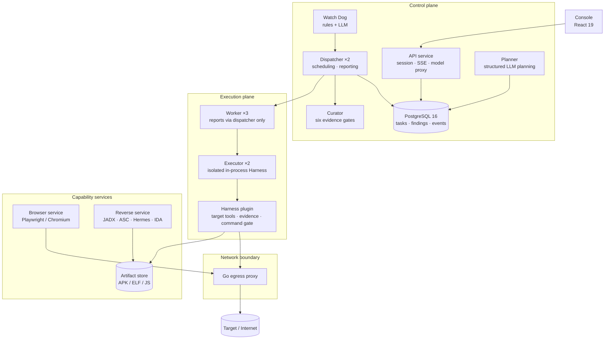
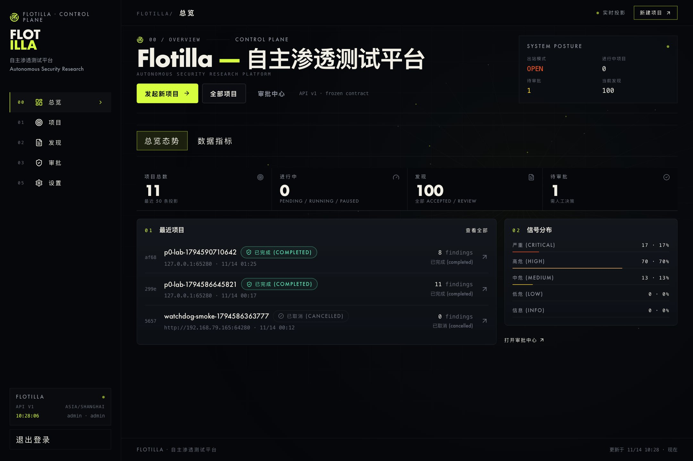
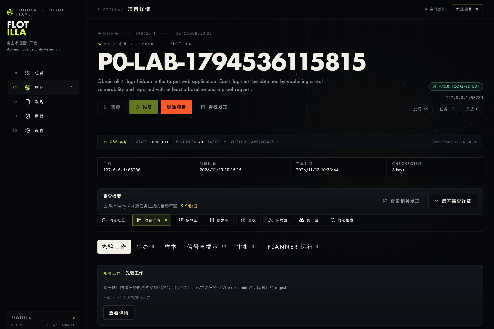
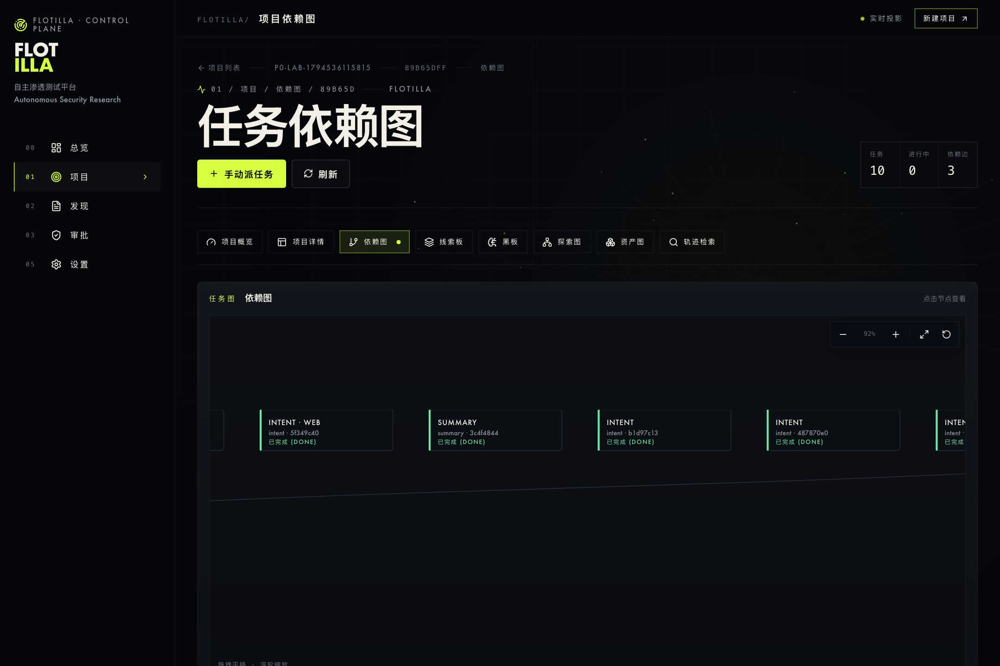
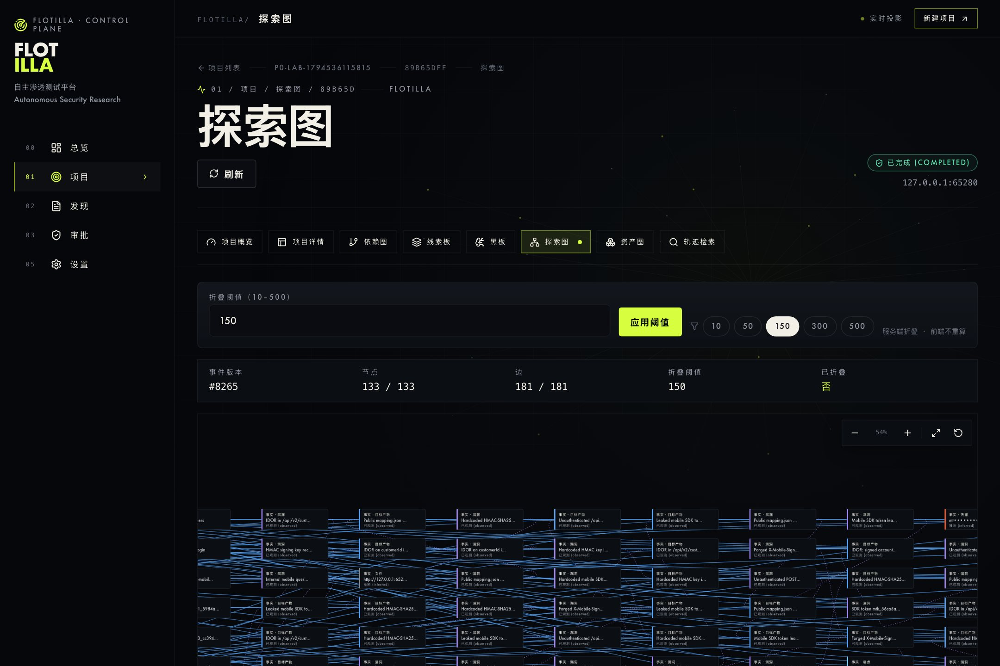
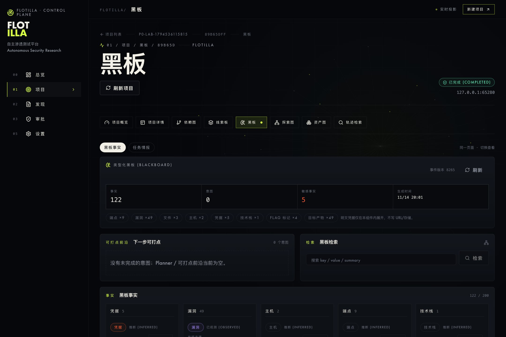
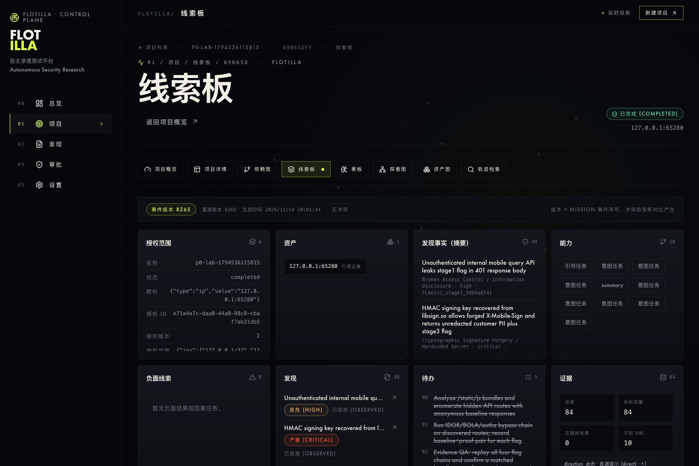

# Flotilla — Autonomous Penetration Testing Platform

[中文](README.md) · **English**

> If I'm a security engineer, would you still love me? This is something I put together while slacking off at work — every security engineer dreams of offensive security research and red teaming…


Give Flotilla your target assets (URL, IP, or domain), an objective, and the authorized scope, and it opens a project: the Planner starts with the stack and keeps reading state, revising the plan, and adding tasks; Workers claim tasks, the Executor calls HTTP, browser, and APK/ELF reverse-engineering tools in an isolated environment, the Curator reviews findings, and a Summary task produces the final report when the project wraps up. The console shows everything in real time — you can pause, inject hints, or dispatch tasks manually.

## Core mechanisms

### Super Agent architecture

Flotilla separates planning, execution, and intervention: the Planner only plans, Workers only execute, the two communicate through events, and you can intervene at any time while a run is in progress.

| Mechanism | How it works |
|---|---|
| Two-layer split | The Planner reads a snapshot each round, reorders tasks, adjusts priorities, and cancels dead ends; it only writes control-plane records and never gets target tools. Workers run one task each and can spawn an isolated recon subagent with its own toolset when needed |
| Event-driven | Mission events and triggers drive the flow; findings, assets, and Watch Dog hints go straight to Workers while anything needing judgement is routed to the Planner |
| Batched planning | Worker reports do not wake the Planner one by one: signals are persisted first, debounced for 5 seconds by default, capped at 20 per batch, then a single planning pass runs with the snapshot |
| Runtime intervention | Hints are written to `task_hints`, forwarded as `steering-hints.jsonl`, and the runtime reads them every 250 ms and injects them at the next step (`agent.steer()`); Workers poll every 2.5 seconds and each delivery writes a `task.hints_steered` audit event; the CLI path falls back to chunked resume |
| Watch Dog | A read-only observer combining rules and an LLM: stalls, direction drift, and duplicate requests are de-duplicated into hints first; repeated stalls escalate to the Planner and a human, the Planner can auto-cancel tasks it deems useless, and outcomes are re-checked after 10 minutes |

### Multiple graphs and shared memory

Tasks, events, findings, and evidence are stored exactly once; every graph and board below is derived from that source instead of maintaining a second source of truth.

| View | What it answers | Source |
|---|---|---|
| Task dependency graph | Which tasks run serially or in parallel, where they are stuck, whether dependencies are satisfied | Task dependencies and task state |
| Exploration graph | What has been discovered, how tasks/facts/targets relate, where to strike next | Derived from the event stream (mission/task/fact nodes) |
| Asset graph | Which assets exist and how much they are covered by tasks/evidence/facts | Asset table and references, with coverage |
| Finding lineage | Where a finding came from, whether evidence is shared, whether it was superseded | Findings and evidence tables |
| Blackboard | Which typed facts, open intents, and next strike points the Planner should remember | Fact/intent views plus the frontier and recall |
| Clue board | A one-screen situation view: scope, assets, finding summary, capabilities, negative clues, todos, evidence | Eight-section projection of the event stream (with version and conflict markers) |

- The blackboard is the Planner's shared memory: typed facts, intents, the frontier, and recall results are injected into the planning snapshot, so planning is grounded in facts rather than conversation history.
- The clue board is for humans: eight sections plus a version number and conflict markers show the project state and missing information at a glance.
- Graphs and boards feed scheduling: the dependency graph decides serial vs parallel execution, the exploration graph decides the next strike point, the asset graph shows coverage, and lineage answers whether a finding is trustworthy.

## What it can test

The 16 skill packs under `skills/` (including the `ck-router` entry point) cover the following areas; `ck-router` triages by target type and decides which layer to try first and what to fall back to.

| Area | Coverage |
|---|---|
| Web vulnerabilities | Injection (SQL, NoSQL, command, SSTI), XSS/CSRF/clickjacking, SSRF and headless-browser rendering, upload/download and path traversal, deserialization/XXE, WAF bypass |
| Auth and authorization | JWT, OAuth, IDOR, CAPTCHA, 2FA, frontend routing and API authorization bypass |
| APIs and protocols | REST, GraphQL, gRPC, WebSocket, gateways, HTTP smuggling, caching |
| Business logic | Payment, order, and inventory logic flaws; concurrency races |
| Assets and endpoints | Subdomain and asset discovery, endpoints and secrets in JS bundles, unauthenticated paths |
| Mobile | APK/mini-program reverse engineering, unpacking, component vulnerabilities, secret and endpoint tracing |
| Binary and firmware | ELF/PE/SO, firmware, protocol reverse engineering, memory corruption |
| Cloud and infrastructure | Cloud assets, object storage and metadata, K8s, middleware, CI/CD, dependency supply chain |
| Code audit | White-box review of source code and decompiled output, from input points to dangerous functions |
| Agent applications | Chatbots/RAG/agent platforms, code-execution sandboxes, agent tool-call chains |

## Architecture and execution flow



Execution flow:

1. Creating a project writes the project record, authorized scope, and initial tasks; the Planner starts with the stack and produces plans, creates tasks, and maintains todos from the snapshot.
2. Workers claim tasks through the Dispatcher, with leases and fencing so a task is only executed by one Worker; they then start the Executor, which runs within step and wall-clock limits and calls tools such as `http_request`, `browser_*`, and `reverse_*`. Target traffic passes through the Go proxy and is allowed according to the authorized scope.
3. Workers report results back to the Dispatcher and submit findings with a baseline and proof request; the Curator runs the six evidence gates and rejects findings whose evidence does not hold; when the project wraps up, a Summary task produces the report, and state is pushed to the console via SSE.

`docker compose up -d` starts the database, egress proxy, API service, console, dispatcher, executors, workers, browser service, reverse service, Watch Dog, and a one-shot artifact-init container. The Planner also starts by default (a valid `LLM_API_KEY` is required); use `docker compose stop planner` if you do not need it. Replica counts are configured in `docker-compose.yml`.

## Interface

<table>
  <tr>
    <td width="50%"><br/><sub>Overview: projects, findings, approvals, and signal distribution</sub></td>
    <td width="50%"><br/><sub>Project detail: live state, tasks, and review results</sub></td>
  </tr>
</table>

<table>
  <tr>
    <td width="50%"><br/><sub>Task dependency graph: layered by dependency, serial/parallel scheduling</sub></td>
    <td width="50%"><br/><sub>Exploration graph: how tasks / facts / targets relate</sub></td>
  </tr>
  <tr>
    <td width="50%"><br/><sub>Blackboard: typed facts, frontier, search (the Planner's shared memory)</sub></td>
    <td width="50%"><br/><sub>Clue board: eight-section situation view (scope / assets / findings / negative clues / todos / evidence)</sub></td>
  </tr>
</table>

Other pages: project list, approval center, Watch Dog dashboard, metrics, model configuration, asset graph, trace search, finding detail.

## Quick start

Docker / Docker Compose; local development additionally needs Node.js 24+.

```bash
cp .env.example .env        # at minimum set LLM_API_KEY; adjust LLM_BASE_URL / LLM_MODEL as needed
docker compose up -d --build
open http://127.0.0.1:5173
```

On first start the system creates an `admin` / `admin123` account and forces a password change at first login (at least 12 characters with upper/lowercase letters, digits, and a special character).

After you create a project in the console, Workers claim tasks automatically.

## Key configuration

`LLM_API_KEY` is required; everything else is optional. Common variables: `LLM_BASE_URL` / `LLM_MODEL`, `EGRESS_MODE` (egress mode, default `scope`), `PLANNER_*`, `WATCHDOG_*`, `ARTIFACT_MAX_BYTES`. Defaults and the full list are in [.env.example](.env.example).

## Tech stack

| Layer | Technology |
|---|---|
| Frontend | Vite, React 19, TypeScript strict, Tailwind v4 |
| Control plane | Node.js 24, `node:http`, zod, PostgreSQL 16 |
| Execution | DeepSeek Harness (in-process), dispatcher with leases/fencing |
| Network and capability services | Go 1.25 egress proxy; Playwright; JADX, ASC, Hermes, IDA idalib |
| Deployment | Docker Compose |

## Repository layout

```text
flotilla/
├── packages/        # orchestration, API, console, harness plugin, curator, contracts, control plane, tool gateway
├── services/        # browser service (Playwright), reverse service (JADX / ASC / Hermes / IDA)
├── proxy/           # Go egress proxy
├── skills/          # 16 skill packs, triaged by ck-router
├── docs/            # architecture decisions, API contracts, screenshots
├── docker-compose.yml
└── LICENSE
```

Docs: [frontend API contract](docs/api/frontend-api.md), [architecture decision records (ADRs)](docs/decisions/).

## License

[MIT](LICENSE) © 2026 Flotilla contributors

See [THIRD_PARTY_NOTICES.md](THIRD_PARTY_NOTICES.md) for the licenses of third-party components (JADX / ASC / agent-skills, etc.).

🚨 For use only against your own lab or targets you are explicitly authorized to test.
